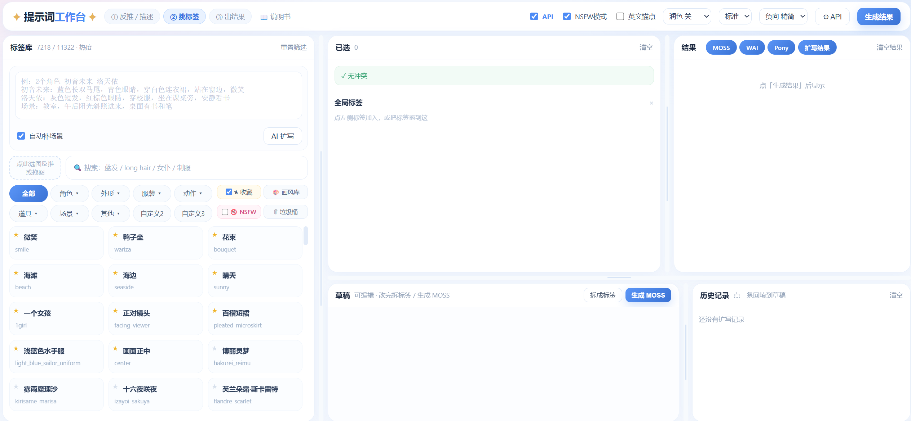

# 提示词工作台（studio2）



一个本地运行的动漫插画**提示词工作台**：从图片反推标签 → AI 扩写 → 拆成标签 → 生成 MOSS / WAI / Pony 提示词。

> ⚠️ 本项目包含成人向（NSFW）词库与内容，**仅限 18 岁以上用户**，仅供个人学习与创作使用。
> 角色名与作品名版权归各自权利人所有，本项目为非官方同人工具，与任何官方无关。

## 功能

- **图反推**：WD14 打标 → 标签自动进入「已选」，同时给出一段中文描述
- **AI 扩写**：DeepSeek API（快、通顺）或本地 Ollama（离线、可写成人内容）
- **拆标签**：中英文标签匹配 + 角色外貌自动补全
- **MOSS / WAI / Pony**：一键生成三套提示词与负向
- **密度三档**：精简 / 标准 / 复杂，按角色与全局分别限制 WAI / Pony 的标签数量（8+6 / 18+14 / 30+24）
- **自动补场景**：没选场景标签时自动补 2~3 个通用场景词（室内 / 柔光 / 阳光…），可在描述框下开关
- **润色四模式**：模板 / 关 / API / 本地
- **词库 11000+**：角色 1600+（219 部作品，带发色瞳色服装）、外形 / 服装 / 动作 / 道具 / 场景
- **界面**：面板尺寸记忆、收藏、拖拽分类、右键编辑角色、历史记录

## 环境要求

| 组件 | 必需 | 说明 |
|---|---|---|
| Python 3.10+ | ✅ | 后端只用标准库 |
| onnxruntime + Pillow + numpy | 图反推 | `wd14_mod.py` 用；缺了只影响图反推 |
| WD14 模型 | 图反推 | `wd-v1-4-moat-tagger-v2.onnx` + 同名 `.csv`，用 `WD14_MODEL` 指定路径 |
| DeepSeek API Key | 可选 | 用于 API 扩写 / API 润色 |
| Ollama | 可选 | 本地扩写与润色 |
| ComfyUI | 可选 | 本项目只生成提示词，出图在 ComfyUI |

### 可选：Ollama 模型

```bash
ollama pull qwen2.5:7b     # 安全内容润色
ollama pull qwen2.5:3b     # 备用
ollama pull goonsai/qwen2.5-3b-goonsai-nsfw-100k:latest   # 成人向润色
```

未安装 Ollama 时，本地扩写会自动降级，不影响其余功能。

### Ollama 故障排查

本地扩写 / 本地润色都走 Ollama（默认 `http://127.0.0.1:11434`），失败不影响其他功能，界面会退回规则模板。排查顺序：

| 现象 | 原因 | 处理 |
|---|---|---|
| 等很久后提示失败，`polish_log.txt` 里 `Connection refused` | 没装 Ollama，或装了没启动 | 从 [ollama.com](https://ollama.com) 安装；`ollama serve` 常驻；`curl http://127.0.0.1:11434/api/tags` 能返回 JSON 即正常 |
| 提示 `model not found`，或润色返回空 | 没拉对应模型 | `ollama pull qwen2.5:7b`（安全）/ `qwen2.5:3b`（备用）/ `goonsai/qwen2.5-3b-goonsai-nsfw-100k:latest`（成人向） |
| 生成时电脑卡顿、显存不足 / OOM | 7B 模型和生图抢显存 | 生图前把「润色」设为 API 或关；或换 3B 模型；`ollama ps` 看占用，`ollama stop <模型>` 立即卸载 |
| 端口不是 11434（改过 `OLLAMA_HOST`） | 后端地址写死 `127.0.0.1:11434` | 改回默认端口（`set OLLAMA_HOST=127.0.0.1:11434`），或改 `expand_mod.py` 里的 `OLLAMA` 常量后重启 8901 |
| 第一次调用特别慢 | 模型正在加载进显存 | 正常现象；可先 `ollama run qwen2.5:7b hi` 预热，或等它 keep_alive 结束前多试几次 |

### 可选：图反推模型（WD14）

默认读 `D:\Dsh-project\ComfyUI_windows_portable\ComfyUI\custom_nodes\ComfyUI-WD14-Tagger\models\wd-v1-4-moat-tagger-v2.onnx`；
换位置时设环境变量：

```bash
set WD14_MODEL=D:\path\to\wd-v1-4-moat-tagger-v2.onnx
set WD14_TAGS=D:\path\to\wd-v1-4-moat-tagger-v2.csv   # 可选，默认取模型同名 .csv
```

中文名直接用项目内的 `tags_cn.json` 映射，不需要任何外部数据文件。

## 快速开始

```bash
git clone <仓库地址>
cd studio2

# 1) 配置 API（可选）
copy api_config.example.json api_config.json
#   填入你的 key

# 2) 启动（Windows）
python app.py
#   或双击 启动工作台.bat

# 3) 打开浏览器
http://127.0.0.1:8901
```

默认端口 **8901**，可在 `app.py` 末尾修改。

## 目录结构

```
studio2/
├── app.py                 后端 HTTP 服务（标准库，无依赖）
├── parse_mod.py           拆标签：中文匹配 + 外貌补全
├── gen_mod.py             MOSS / WAI / Pony 生成 + 负向自适应
├── expand_mod.py          扩写：DeepSeek / Ollama
├── wd14_mod.py            图反推：WD14 onnx 本地打标（不依赖 ComfyUI / 老工作台）
├── static/                前端（index.html + app.js）
├── styles/                画风库 50 张
├── docs/                  README 截图
├── tags_cn.json           词库（11000+ 条）
├── chars_app.json         角色外貌表
├── chars_extra.json       补充角色
├── custom_chars.json      用户自定义角色（运行时生成，不入库）
├── api_config.json        API 配置（不入库）
├── verify_density.py      密度三档自检脚本（python verify_density.py）
└── build_*.py             词库构建脚本（可重跑）
```

## 数据说明

- `tags_cn.json`：`{zh, en, cat, sub, nsfw, app}`，角色条目带外貌五字段
- `chars_app.json`：角色 `hair / eyes / outfit / body / chest` 中文描述
- 用户自定义角色写入 `custom_chars.json`，优先级高于内置

## 数据存储

数据全部在本机，不上传云端（只有勾选「API」或润色选「API」时，文字才会发给 DeepSeek）。前端数据在浏览器 localStorage，清浏览器数据会丢；自定义角色与 API 配置另外落盘到服务器目录。

**localStorage 键**

| 键 | 内容 |
|---|---|
| `settings` | 顶部开关与下拉：`api` / `nsfwTop` / `autoScene`（自动补场景）/ `density`（密度）/ `polishMode`（润色）/ `neg`（负向）/ `nsfw` / `favTop` |
| `pane` | 各面板宽度 / 高度记忆 |
| `favTags` | ★ 收藏的标签（英文 tag 数组） |
| `catOverrides` | 拖动标签后的分类覆盖 `{ en: { cat, sub } }` |
| `catLabels` | 分类改名 |
| `catHidden` | 隐藏的分类 |
| `cats` | 自建的顶级分类 |
| `customChars` | 自定义角色（与 `custom_chars.json` 双向同步） |
| `customSubs` | 自建的子分类 |
| `apiCfg` | API 地址 / 模型 / Key 的前端副本 |
| `hist` | AI 扩写历史，最多 30 条 |

其余运行期状态（已选标签、角色框、搜索结果）不持久化，刷新即清空。

**服务器文件**

| 文件 | 内容 | 是否入库 |
|---|---|---|
| `custom_chars.json` | 用户自定义角色，与 localStorage `customChars` 同步 | 否 |
| `api_config.json` | DeepSeek API 地址 / 模型 / Key | 否 |
| `tags_cn.json` | 词库本体，改完刷新页面即可（前端只在加载时读一次） | 是 |

## NSFW 说明

- 词库中约 4000 条标记 `nsfw: true`
- 界面顶部「NSFW模式」控制扩写是否生成成人内容
- 关闭时：正向过滤 NSFW 标签，WAI/Pony 负向自动追加裸露类词
- MOSS 负向不受该开关影响

## 常见问题（FAQ）

**Q1 为什么生成结果是标签串，不是通顺的中文段落？**
「润色」选了「关」或「模板」。改成「API」或「本地」重新生成即可；只关心 WAI / Pony 的话不受影响。这两种模式本来就是直接输出标签式 MOSS，最快。

**Q2 为什么图反推结果里有英文，没翻译成中文？**
词库 `tags_cn.json` 里暂时没有该词的中文译名，只能原样显示英文 tag。多数是冷门画风 / 作品 / 品牌词，可以当普通标签用，或丢进「自定义」分类收纳；补齐词库后刷新页面即可。

**Q3 为什么角色外观和我的设定不符？**
词库里的角色自带外观（发色 / 瞳色 / 服装），生成时会自动补全。你手动加的同类标签优先，自动外观会跳过对应类别；也可以右键角色卡直接改外观并保存。想完全控制就自己把发色 / 瞳色 / 服装逐个加进角色框。

**Q4 为什么画不出多个角色？**
单角色时负向会自动追加 `2girls / multiple_girls / split_screen / character_sheet` 等防克隆词。要多角色：加多个角色框，每个框放各自的标签；位置标签（画面左侧 / 右侧）也放进对应角色框；仍画不出就把负向改成「精简」或「关」，并确认 WAI / Pony 正向里有 `(2girls:1.45)`。

**Q5 8901 打不开 / 页面白屏怎么办？**
先确认进程在跑：任务管理器看有没有 `pythonw.exe`，命令行是否含 `studio2\app.py`；没有就用「启动工作台.bat」或 `pythonw app.py` 启动。再访问 <http://127.0.0.1:8901>。还不行查端口占用：`netstat -ano | findstr 8901`。页面白屏多半是浏览器缓存了旧 `app.js`，强制刷新（Ctrl+F5）即可，版本号就在 `index.html` 末尾的 `app.js?v=`。

**Q6 改了词库 / 服务端文件，要不要重启？**
`tags_cn.json`、`chars_app.json` 只在页面加载时读一次，改完刷新页面就生效，不用重启服务；但 `app.py`、`gen_mod.py` 等 Python 代码改动必须重启 8901。前端新增 / 编辑 / 删除的角色会立即生效，并同步写 `custom_chars.json`。

**Q7 密度选了三档，为什么输出看起来一样？**
密度只裁剪 WAI / Pony 的英文标签数量（精简 每角色 8 / 全局 6，标准 18 / 14，复杂 30 / 24），标签本来就少于上限时三档完全一致；MOSS 中文段落不读这个参数。可用 `python verify_density.py` 自检三档字符数是否递增。

**Q8 「自动补场景」补进去的是哪些词，会不会写进已选？**
只在「已选里没有任何场景类标签」时生效：从词库随机挑 2~3 个通用场景词（优先 室内 / 柔光 / 阳光 / 白天，避免奇怪场景），生成时的提示会列出补了哪几个。它们只进本次请求，不写进「已选」；不想要就取消勾选，状态会记住。

## 许可证

MIT，详见 [LICENSE](LICENSE)。

## 致谢

- [DeepSeek](https://deepseek.com) — API 扩写与润色
- [Ollama](https://ollama.com) — 本地模型
- [ComfyUI](https://github.com/comfyanonymous/ComfyUI) — 出图
- [SmilingWolf](https://huggingface.co/SmilingWolf) — WD14 标签模型（wd-v1-4-moat-tagger-v2）作者，图反推基于其模型与标签表
